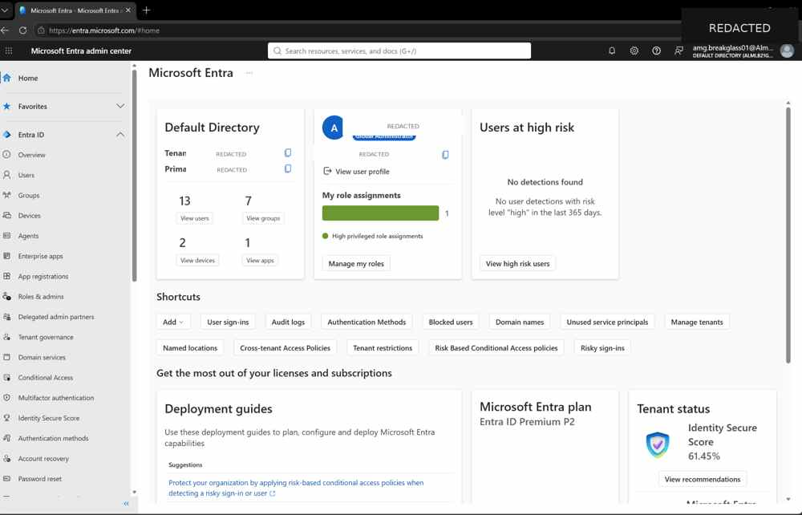
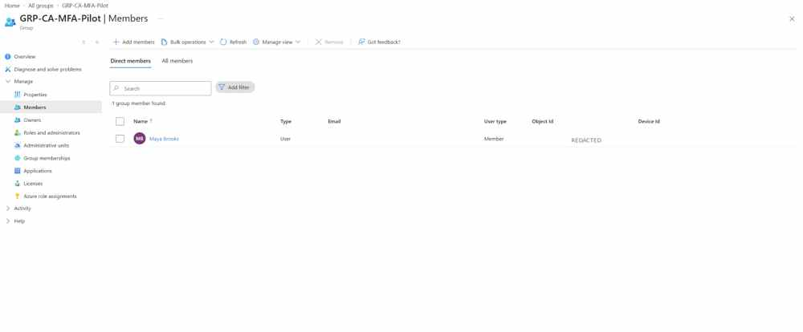
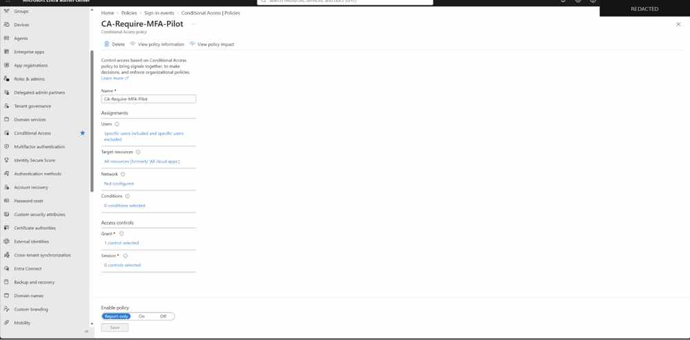
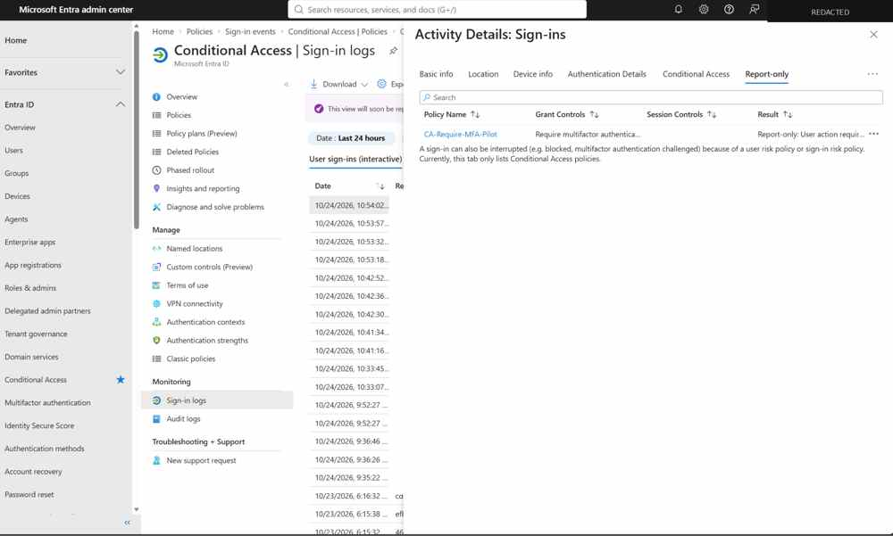
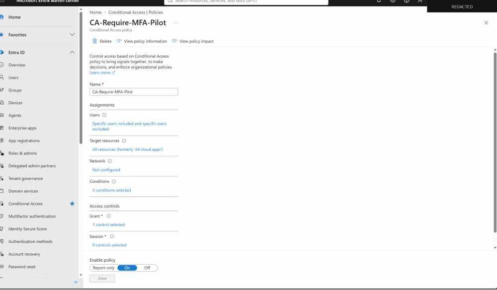
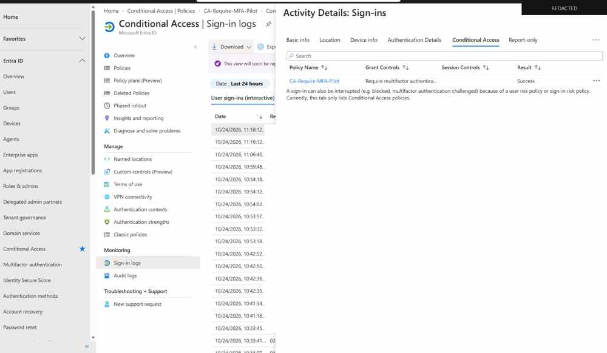
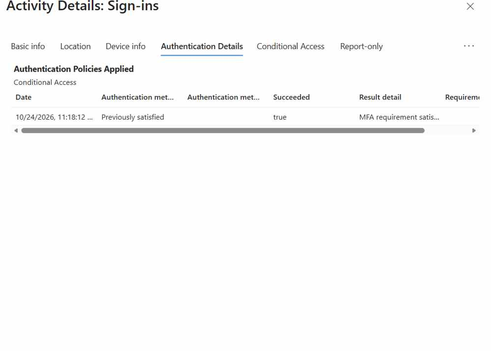
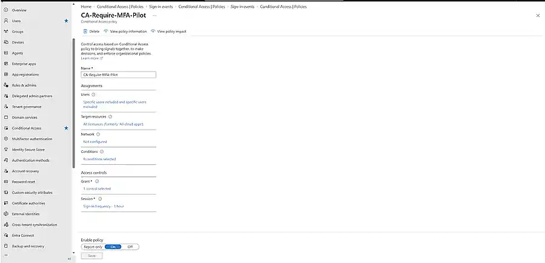
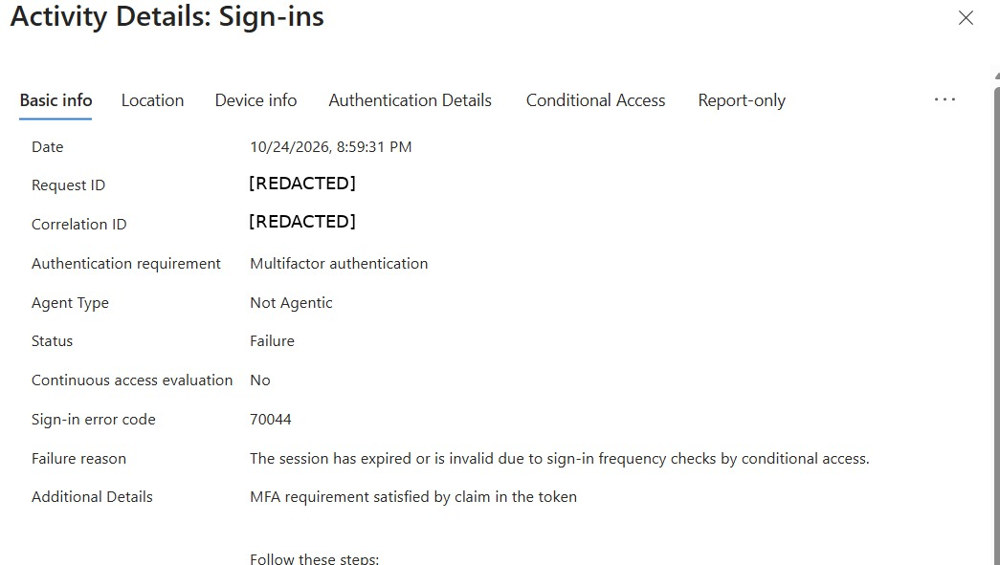

# IAM-1054 Evidence Guide

This public evidence set documents the Conditional Access MFA pilot from initial safety controls through enforcement and session validation. Tenant-specific identifiers, account identifiers, object IDs, and sign-in event IDs were redacted before publication.

## Core Conditional Access build and validation

### 1. Break-glass Global Administrator validated

Validated the emergency-access account and Global Administrator role before changing tenant-wide authentication controls.

### 2. MFA pilot group scoped to Maya Brooks

Confirmed Maya Brooks as the pilot identity in `GRP-CA-MFA-Pilot`, limiting the initial Conditional Access blast radius.

### 3. CA policy staged in Report-only

Created `CA-Require-MFA-Pilot` with the MFA grant control and staged it in Report-only before enforcement.

### 4. Report-only evaluation captured

Used sign-in logs to confirm how the pilot policy would evaluate before turning it on.

### 5. CA policy enabled

Moved the validated pilot policy from Report-only to On after reviewing the expected impact.

### 6. Conditional Access success

Confirmed the enforced policy evaluated successfully during the pilot sign-in.

### 7. MFA requirement satisfied

Authentication Details showed the MFA requirement was satisfied by a previously satisfied authentication claim.

## Session-control extension

### 8. Sign-in Frequency configured to 1 hour

Added a 1-hour Sign-in Frequency with periodic reauthentication to test session-lifetime behavior separately from MFA satisfaction.

### 9. Session expiration — Error 70044

Captured the expected session-expiration event caused by the Sign-in Frequency control.

## Key engineering lesson

**MFA satisfaction and session lifetime are separate controls.** A user can satisfy the MFA grant through an existing claim while Conditional Access still forces periodic session reevaluation through Sign-in Frequency.
