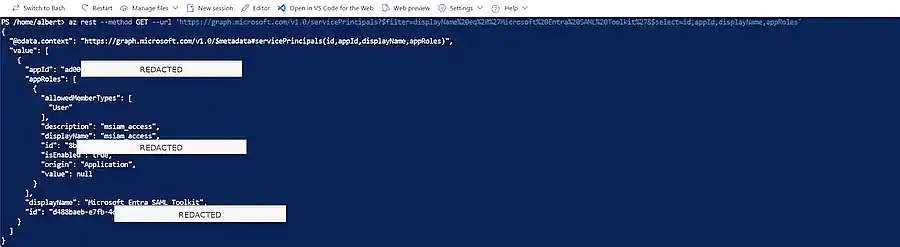
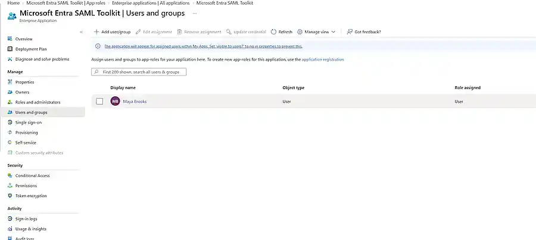

# IAM-1055 Evidence Guide

This public evidence set is a sanitized subset of the original IAM-1055 screenshots. Real tenant IDs, object IDs, request/correlation IDs, administrator UPNs, IP data, and other tenant-specific identifiers were removed before publication.

RouteSphere is the fictional APEX business scenario. Microsoft Entra SAML Toolkit is the real Service Provider used for end-to-end protocol validation.

## Published evidence

### 1. Microsoft Graph root-cause analysis

The service principal inspection showed the default `msiam_access` role had a null value. That explained why the expected meaningful role value was not appearing in the SAML assertion.

### 2. Final application-role assignment

Shows the cleaned-up final entitlement state with the meaningful `User` role assigned after validation and redundant access removed.

## Evidence retained outside the public repo

The working set also includes the Toolkit SAML configuration, NameID/claims configuration, successful sign-in logs, and decoded SAML assertion used during IAM-1055. Those artifacts remain available in the project record but are not all published here.
